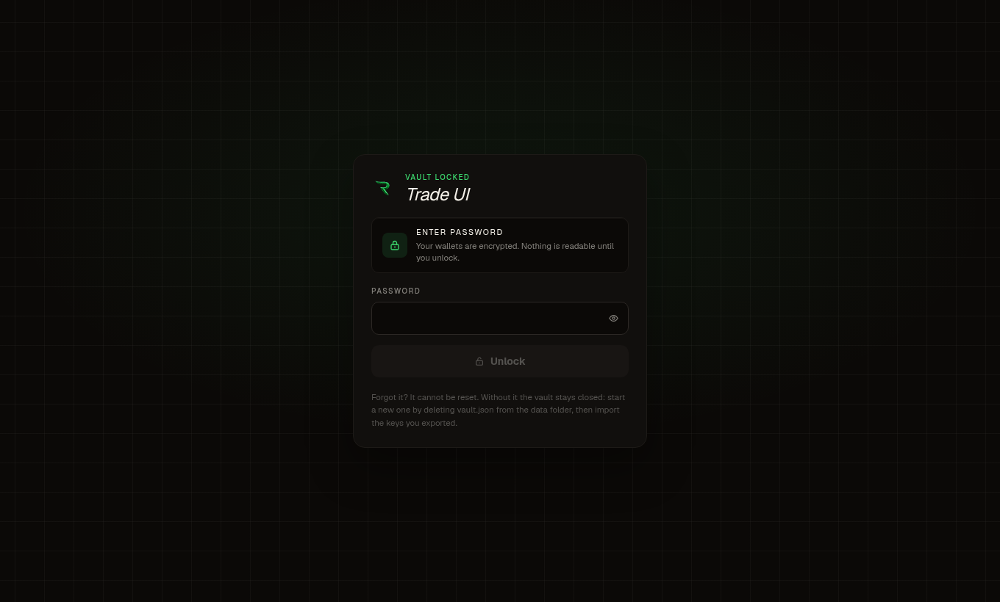
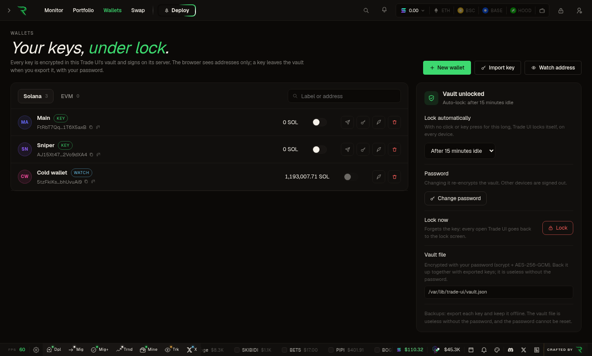

# Raze Trade UI

A self-hosted trading terminal for [Raze](https://raze.bot): live launchpads,
token pages with charts, trades and holders, a portfolio, and swaps on the
Raze routers (Solana; Ethereum, BNB Chain, Base and Robinhood) — signed by
wallets that live encrypted on **your** machine or server, behind a password,
like a hardware wallet.

Run it in the browser from a server you own (a VPS), or as a desktop app on
Windows, macOS and Linux. There is no account and no third-party login: one
Raze API key in the server's configuration, and one password for the vault.

| Lock screen | Wallets |
| --- | --- |
|  |  |

## Contents

- [How it works](#how-it-works)
- [Run it on your computer](#run-it-on-your-computer)
- [Host it on a server](#host-it-on-a-server)
- [Desktop app](#desktop-app)
- [Configuration](#configuration)
- [The lock and the wallets](#the-lock-and-the-wallets)
- [Swaps](#swaps)
- [Development](#development)
- [Troubleshooting](#troubleshooting)
- [Security](SECURITY.md) · [License](LICENSE)

## How it works

```
 browser ──────────────► Trade UI server (server.mjs) ──────► api.raze.bot   market data, REST + WebSocket
  │ pages, charts,         │ the lock: password → session          (RAZE_API_KEY added here)
  │ addresses only         │ the vault: encrypted keys      ──────► router.raze.bot  quotes, swap builds (/evm: EVM)
  │                        │ signs swaps and transfers      ──────► Solana / EVM RPCs  send, confirm, balances
  └─ never sees a key      └─ data/vault.json (0600)
```

- **One server process** serves the app and holds everything secret: the Raze
  API key (from its environment) and the vault of wallet keys (in its data
  folder). The browser gets addresses, balances and charts.
- **Everything under `/api/` is locked** until the password is entered. The
  password unlocks the vault; locking forgets the key.
- **Swaps:** the server asks the router for a quote and keeps it; the browser
  shows it and, to trade, names it. The server builds exactly that quote on
  the router for your wallet, signs it with the vault's key and sends it; the
  browser waits for the confirmation.

The full security model, and what it does not cover, is in
[SECURITY.md](SECURITY.md).

## Run it on your computer

Requirements: Node.js 22.18 or newer (24 recommended), and a Raze API key from
[raze.bot](https://raze.bot).

```bash
git clone <this repository> trade-ui
cd trade-ui
npm ci
cp .env.example .env        # put your key in RAZE_API_KEY
npm run build
npm start
```

The server prints a link on its first start:

```
> trade-ui 0.2.0 on http://127.0.0.1:3000
  First run: choose your password at
    http://127.0.0.1:3000/?setup=Xq3…
```

Open it and choose a password. Trade UI then shows your **recovery key** once:
nine groups of four characters. Write it down and keep it offline; if you ever
forget the password, it sets a new one and your wallets stay. From then on
every visit asks for the password. The setup code in the link proves you run
the server; without it nobody can set the first password.

Prefer a window of its own? See [Desktop app](#desktop-app).

## Host it on a server

Trade UI on a VPS is the same server, reached through **HTTPS**: over plain
HTTP your password would cross the network readable.

### With Docker

```bash
cp .env.example .env
# RAZE_API_KEY=…
# TRADE_UI_PUBLIC_URL=https://trade.example.com
docker compose up -d
docker compose logs trade-ui     # the first-run link with the setup code
```

[docker-compose.yml](docker-compose.yml) publishes the port on 127.0.0.1 only;
the vault is in the `trade-ui-data` volume. Put a reverse proxy in front, for
example [Caddy](deploy/Caddyfile), which gets the certificate and passes
WebSockets as they are:

```
trade.example.com {
	reverse_proxy 127.0.0.1:3000
}
```

### With systemd

```bash
npm ci && npm run build && npm run bundle   # dist/server: the server and what it needs
sudo mkdir -p /opt/trade-ui && sudo cp -r dist/server/. /opt/trade-ui/
sudo useradd --system --home /var/lib/trade-ui tradeui
sudo install -m 600 .env /etc/trade-ui.env
sudo cp deploy/trade-ui.service /etc/systemd/system/
sudo systemctl enable --now trade-ui
journalctl -u trade-ui                       # the first-run link
```

The [unit](deploy/trade-ui.service) runs it as its own user, listening on
127.0.0.1, with the vault in `/var/lib/trade-ui`.

### Checklist

- HTTPS in front, and `TRADE_UI_PUBLIC_URL` set to its address: Trade UI
  answers `localhost` and IP addresses, and a domain only once it is told
  about it (protection against DNS rebinding); with an `https://` address it
  also marks its cookie `Secure` and sends HSTS.
- Nginx instead of Caddy: pass `Host`, `X-Forwarded-Proto`, and the WebSocket
  upgrade (`proxy_http_version 1.1`, `Upgrade`, `Connection`).
- Choose a long password: the server can be reached by anyone who finds it.
  Wrong passwords slow down for the address that typed them (up to 5 minutes
  between attempts), so a guesser elsewhere cannot lock you out. Behind a
  reverse proxy on the same machine the address is taken from the proxy's
  `X-Forwarded-For` (Caddy and Nginx set it).
- Back up the data folder and keep the recovery key offline: without the
  password or the recovery key, the vault cannot be opened.

## Desktop app

Installers are attached to each [release](../../releases): `.exe` (installer
or portable) for Windows, `.dmg` for macOS (Intel and Apple Silicon),
`.AppImage`, `.deb` and `.tar.gz` for Linux.

On first launch the app asks for your Raze API key (and, optionally, your own
Solana RPC), then for the vault password. It runs the same server inside,
listening on 127.0.0.1 only.

- Settings: menu **Trade UI → Settings…** (API key, RPC). **Lock** is
  Ctrl/Cmd+L.
- Data: **Trade UI → Open data folder** — `config.env` (the API key) and
  `data/vault.json`. On Linux `~/.config/Raze Trade UI`, on macOS
  `~/Library/Application Support/Raze Trade UI`, on Windows
  `%APPDATA%\Raze Trade UI`.

### Build it yourself

```bash
npm ci
npm run dist          # this OS; or dist:linux, dist:win, dist:mac
ls release/
```

Each OS builds best on itself; [the workflow](.github/workflows/release.yml)
builds all three on GitHub Actions and attaches them to a draft release when a
`v*` tag is pushed.

### Signing

Unsigned builds work, with a warning: Windows SmartScreen ("More info → Run
anyway"), macOS Gatekeeper (right-click → Open). To sign in CI, set these
repository secrets: `CSC_LINK` and `CSC_KEY_PASSWORD` (Apple Developer ID
certificate), `APPLE_ID`, `APPLE_APP_SPECIFIC_PASSWORD` and `APPLE_TEAM_ID`
(notarization), `WIN_CSC_LINK` and `WIN_CSC_KEY_PASSWORD` (Windows).

## Configuration

All of it lives in the server's environment or `.env` (desktop: `config.env`).
None of it reaches the browser.

| Variable | Default | |
| --- | --- | --- |
| `RAZE_API_KEY` | — | Your Raze key. Sent as `x-api-key` to the API and the router. |
| `RAZE_API_BASE` | `https://api.raze.bot` | The market-data API. |
| `RAZE_ROUTER_BASE` | `https://router.raze.bot` | The Solana router: quotes and builds. |
| `RAZE_ROUTER_EVM_BASE` | `https://router.raze.bot/evm` | The EVM router: quotes and builds on Ethereum, BNB Chain, Base and Robinhood. Same key. |
| `EVM_RPC_URL_ETH`, `_BSC`, `_BASE`, `_ROBINHOOD` | free public RPCs (below) | Sends, reads balances and receipts. Must answer `eth_getTransactionReceipt`. Use your own for real volume. |
| `EVM_WS_URL_ETH`, `_BSC`, `_BASE`, `_ROBINHOOD` | your RPC's with `ws(s)://`, else publicnode's | New blocks (`newHeads`), on which a sent swap's receipt is read. |
| `SOLANA_RPC_URL` | `https://api.mainnet-beta.solana.com` | Sends and confirms, reads balances. Must accept v1 transactions (SIMD-0385). Use your own for real volume; a key in the URL stays on the server. |
| `SOLANA_WS_URL` | the RPC URL with `ws(s)://` | Confirmations. |
| `SWAP_PRIORITY_MAX_LAMPORTS` | `500000` | Cap of the router's priority-fee estimate when you set none. |
| `SWAP_ALLOW_SPLIT` | off | `1` lets a quote split across two routes. |
| `SWAP_MAX_SLIPPAGE_BPS` | `5000` | The most slippage a quote may ask for (5000 = 50 %). |
| `HOST` | `127.0.0.1` | Where to listen. |
| `PORT` | `3000` | |
| `TRADE_UI_DATA_DIR` | `./data` | The vault's folder. |
| `TRADE_UI_PUBLIC_URL` | — | The address you open it at, when it is a domain name (needed then). |
| `TRADE_UI_ALLOWED_HOSTS` | — | More host names to answer for, comma-separated. |
| `TRADE_UI_SETUP_TOKEN` | random | A fixed first-run setup code (automation). |

The EVM defaults: Ethereum and Robinhood `https://ethereum-rpc.publicnode.com`
and `https://robinhood-rpc.publicnode.com`; BNB Chain
`https://bsc-dataseed.bnbchain.org`; Base `https://mainnet.base.org`. The last
two are the chains' own endpoints because publicnode's free tier does not
answer receipts there. New blocks come from publicnode's WebSockets.

## The lock and the wallets

**The password** is chosen on the first run and asked on every visit, by every
browser. Wrong passwords slow down. **Lock** (the padlock in the top bar, or
Ctrl/Cmd+L on desktop) ends every session at once, with every stream and
WebSocket they had open; so does the idle delay (Wallets → Lock
automatically: 5 minutes to 4 hours, or never) and a restart.
Change the password from the same panel; the recovery key keeps working.

**Forgot the password?** On the lock screen, *Forgot your password?* → enter
the recovery key and a new password. The wallets stay as they are; every other
open Trade UI goes back to the lock screen. The recovery key keeps working
afterwards, like a hardware wallet's recovery phrase. Lost it, or think
someone saw it? Wallets → Security → *New recovery key* (asks the password)
retires the old one. Without both the password and the recovery key the vault
stays closed: keep exported keys as a last backup.

**The Wallets page** (top bar → Wallets):

- **New wallet** — Solana or EVM; several at once, numbered.
- **Import key** — Solana: base58 (Phantom, Solflare, Backpack export) or a
  keypair file (`solana-keygen`, `id.json`). EVM: the hex key (MetaMask,
  Rabby). One per line for many, or load a file. Seed phrases are not
  supported: export the account's private key from your wallet.
- **Watch address** — balances and holdings of an address you do not hold the
  key of. It never trades.
- **Export key** (password) — base58 and the keypair JSON, or EVM hex.
- **Send SOL** (password) — to any address, or everything ("Max").
- **Delete** (password, for a wallet with a key) — the key leaves the vault for
  good.
- **Trading switch** — which wallets the panels and quick buys trade with
  (also in the top bar's wallet picker). Several at once: one trade each.

One EVM key is the same address on Ethereum, BNB Chain, Base and Robinhood,
and trades on all four. Sending coins runs on Solana for now.

Upgrading from a version that kept wallets in the browser (unencrypted, in
`localStorage`): the Wallets page offers to move them into the vault and then
erases the browser copy. An entry the vault refuses stays in the browser, with
the reason, until you discard it. The desktop app starts from an empty
browser: import those keys by hand.

## Swaps

On Solana the Raze router swaps; on Ethereum, BNB Chain, Base and Robinhood
the Raze EVM router does (below, [On the EVM chains](#on-the-evm-chains)).

Where you trade: the token page's panel (market buy and sell, presets, the
floating Instant Trade panel), the ⚡ quick buy on monitor rows and the
sidebar's quick buy / sell, and `/swap` for any pair.

Every trade is the same path:

1. **Quote** — `GET /api/swap/quote` → router `GET /quote`, shown under the
   amount (output, impact, venues). The server keeps the router's answer for a
   minute and hands the browser a `quoteToken` with it. `/swap` refreshes it
   every 800 ms while visible: the router has no push stream.
2. **Build, sign, send** — `POST /api/wallets/{id}/swap` with that token: the
   server asks the router to build the quote it kept, as the router gave it,
   for the wallet (`/swap-instructions`, so the floor shown is the floor the
   program enforces), checks the wallet is the only signer, signs with the
   vault's key and sends with preflight: a swap that would fail is refused
   before it costs a fee. Nothing the browser sends can change the route, the
   amounts or the minimum received.
3. **Confirm** — `signatureSubscribe` on `/api/solana/ws`, which the server
   forwards to the RPC's WebSocket.

The priority fee is the panel's ⛽ value (total lamports); slippage is the 🔥
value, up to `SWAP_MAX_SLIPPAGE_BPS` (50 % unless you set it). A sell by % reads the exact token balance: 100% sells every last unit.
Market orders only: a trade is swapped on the router when you press the button.
Trade UI has no limit orders, no automations (TP/SL ladders, market making), no
wallet or X trackers, and it does not launch tokens.

### On the EVM chains

The same places trade, through the EVM router (`RAZE_ROUTER_EVM_BASE`), with
an EVM wallet of the vault:

The EVM router speaks the Solana router's API (`inputMint`, `outputMint`,
`amount`; a quote with `routePlan`; `/swap` with the quote as `quoteResponse`).

1. **Quote** — `GET /api/evm/quote?chain&inputMint&outputMint&amount` →
   router `GET /quote`, kept a minute under a `quoteToken`, shown under the
   amount (output, minimum, venue) and refreshed every 2 s while visible.
2. **Build, check, sign, send** — `POST /api/wallets/{id}/swap` with that
   token: the router builds the kept quote for the wallet (`POST /swap` with
   it as `quoteResponse`). The server signs only if the router's simulation
   passed and every transaction is what the quote says: from this wallet, on
   this chain, with the quote's amount and minimum; approvals
   (`setupTransactions`) only of the token you pay with, only to the venue's
   router, for at most the amount; the swap (`swapTransaction`) to that
   router with the quote's value. It signs them as EIP-1559 transactions with
   the router's gas and fees and sends them in nonce order.
3. **Confirm** — `POST /api/evm/confirm`: the server reads the swap's receipt
   on each new block the chain's WebSocket announces, and says if it reverted.

The EVM router quotes exact amounts in: on EVM chains you buy by what you
spend and sell by an amount or a share of the holding (the panel says so for
the other denominations). Slippage tops out at 50 %. A token you pay with is
approved for the exact amount before the swap, in its own transaction; the
priority fee setting is Solana's (the router suggests EVM fees).

## Development

```bash
npm ci
cp .env.example .env
npm run dev               # http://127.0.0.1:3000, hot reload (setup link in the log)
npm test                  # server: vault, lock, quotes, signing, the gate; browser: trades, key import
npm run typecheck
npm run electron:dev      # the desktop shell around the dev server
```

Always start it through `server.mjs` (`npm run dev` / `npm start`), not `next`
directly: the API routes refuse to serve without the lock in front of them.

| Path | |
| --- | --- |
| `server.mjs` | The server: Next.js behind the gate. |
| `server/` | The lock (`auth.mjs`), the vault (`vault.mjs`, `keys.mjs`), the routes (`api.mjs`), the gate (`gate.mjs`), kept quotes (`quotes.mjs`), swaps and transfers (`solana.mjs`), the WebSocket proxies. |
| `src/app/` | Pages (`monitor`, `token`, `portfolio`, `wallets`, `swap`) and the proxy routes under `api/`. |
| `src/components/shell/LockGate.tsx` | The lock screen and first run. |
| `src/lib/vault/` | The browser's client for the lock and the wallets. |
| `electron/` | The desktop shell and its first-run window. |
| `scripts/bundle-server.mjs` | `dist/server` (self-contained server) and `dist/app` (desktop). |
| `test/` | Server tests (`node --test`). |

## Troubleshooting

- **"Trade UI does not answer for this host name"** — you opened it at an
  address it was not told about. Set `TRADE_UI_PUBLIC_URL` (or
  `TRADE_UI_ALLOWED_HOSTS`) and restart.
- **"No Raze API key on this server"** — `RAZE_API_KEY` is empty: set it in
  `.env` (desktop: Settings…) and restart.
- **"Wrong setup code"** — copy the code from the server's log of *this* start;
  a fixed one can be set with `TRADE_UI_SETUP_TOKEN`.
- **Forgot the password** — lock screen → *Forgot your password?*, with the
  recovery key. Lost that too: stop Trade UI, move `vault.json` out of the
  data folder, start again: a new vault, into which you import the keys you
  exported.
- **"Start Trade UI with npm run dev or npm start"** — the API routes were
  reached without `server.mjs` in front (plain `next dev`/`next start`).
